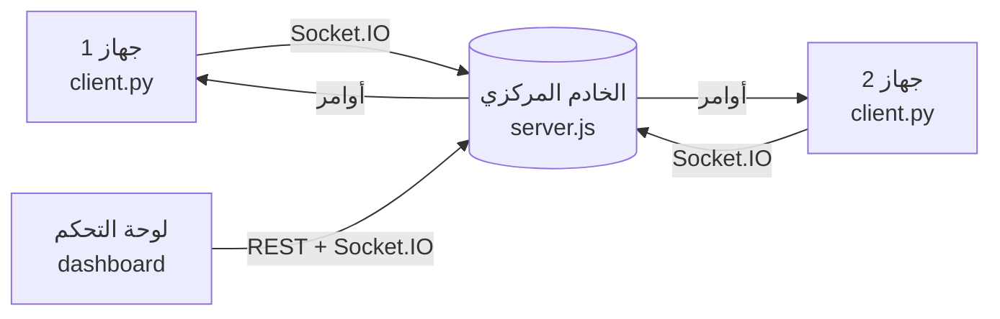

# Remote Control System | نظام التحكم بالأجهزة عن بُعد 🖥️🌐

نظام بيخليك تتحكم بأجهزة كمبيوتر (ويندوز) عن بُعد عبر الإنترنت. كل جهاز بيشغّل برنامج صغير (Client) بيتصل بـ **خادم مركزي** (Server)، ولوحة تحكم ويب (Dashboard) بتعرض كل الأجهزة المتصلة وبتبعتلها أوامر.

> ⚠️ هاد المشروع للاستخدام على أجهزتك الشخصية وبإذن صاحب الجهاز. لا تستخدمه للتحكم بأي جهاز بدون إذن.

## 🧩 المكوّنات

```
remote-control-system/
├── server/       الخادم المركزي (Node.js + Socket.IO)
│   ├── server.js
│   ├── config.example.json   ← انسخه لـ config.json وحط كلمة السر
│   └── package.json
├── client/       البرنامج اللي بيشتغل على كل جهاز (Python)
│   ├── client.py
│   ├── config.example.ini    ← انسخه لـ config.ini وعبّي الإعدادات
│   └── requirements.txt
└── dashboard/    لوحة تحكم ويب
    ├── index.html
    ├── script.js
    └── style.css
```

## ⚙️ كيف بيشتغل



1. **التسجيل:** كل Client بيتصل بالخادم وبيسجّل نفسه بـ `deviceId` واسم وكلمة سر. إذا كلمة السر غلط، الخادم بيرفض الاتصال.
2. **نبضات القلب (Heartbeat):** الـ Client بيبعت نبضة كل 20 ثانية. إذا الخادم ما وصلته نبضة خلال 40 ثانية، بيعلّم الجهاز إنه **غير متصل (offline)**.
3. **الأوامر:** لوحة التحكم (أو أي طلب REST مع كلمة السر) بتبعت أمر لجهاز معيّن، والخادم بيمرّره للجهاز المقصود عبر Socket.IO.

## 🎛️ الأوامر المدعومة

| الأمر | الوظيفة |
|---|---|
| `play_song` | يشغّل ملف صوتي على الجهاز (أو أول ملف صوتي بالمجلد المحدد) |
| `keep_awake` | يمنع الجهاز من الدخول بوضع السكون (Windows API) |

الـ Client كمان:
- بيخفي نافذة الكونسول على ويندوز لما يشتغل.
- بيضيف نفسه لبرامج **بدء التشغيل التلقائي** (عبر مفتاح الريجستري `...\CurrentVersion\Run`).

## 🔌 واجهة الخادم (REST API)

كل الطلبات بتحتاج ترويسة: `Authorization: Bearer <password>`

| الطريقة | المسار | الوظيفة |
|---|---|---|
| `GET` | `/api/devices` | قائمة الأجهزة وحالتها |
| `POST` | `/api/command/:deviceId` | إرسال أمر لجهاز (body: `{ command, data }`) |

## 🚀 التشغيل

### 1. الخادم

```bash
cd server
npm install
cp config.example.json config.json   # وبعدين عدّل كلمة السر والمنافذ
npm start
```

الخادم بيشتغل على المنفذ `3000` ومتاح من أي شبكة. تأكد إن الجدار الناري بيسمح بالمنفذ.

### 2. الـ Client (على كل جهاز)

```bash
cd client
pip install -r requirements.txt
cp config.example.ini config.ini      # وبعدين عبّي عنوان الخادم وكلمة السر
python client.py
```

### 3. لوحة التحكم

افتح `dashboard/index.html`، وحط عنوان الخادم وكلمة السر.

## 🔐 الأمان

- **كلمات السر مش محفوظة بالمستودع.** ملفات `config.json` و `config.ini` الحقيقية متجاهَلة في `.gitignore`. استعمل الملفات اللي اسمها `*.example.*` كنقطة بداية.
- الخادم بيستخدم نفس كلمة السر لتسجيل الأجهزة ولطلبات الـ API — غيّرها لكلمة قوية.
- الاتصال حالياً عبر HTTP عادي، فالأفضل تشغّله خلف HTTPS (مثلاً عبر reverse proxy) إذا رح تستعمله على الإنترنت.

## 🧰 التقنيات

- **الخادم:** Node.js، Express، Socket.IO، CORS
- **الـ Client:** Python، python-socketio، pywin32 (Windows API)، PyInstaller (لتجميعه كـ EXE)
- **لوحة التحكم:** HTML / CSS / JavaScript
